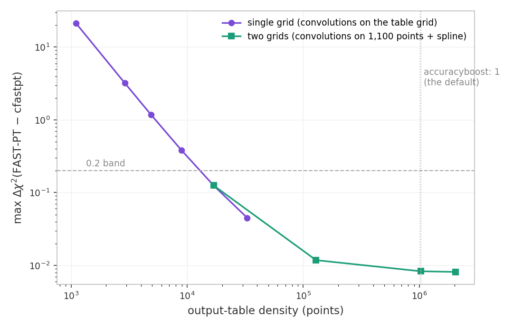
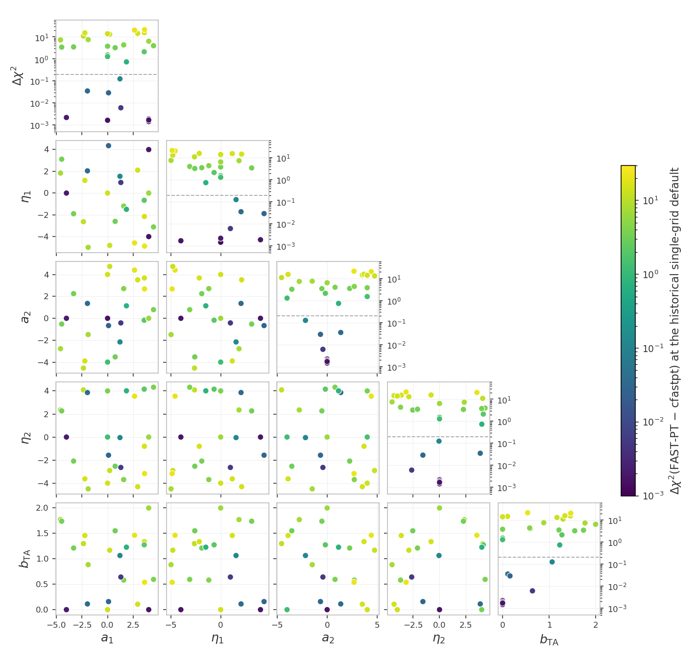
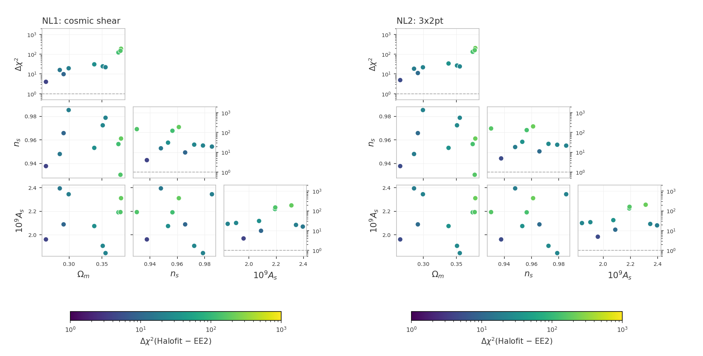
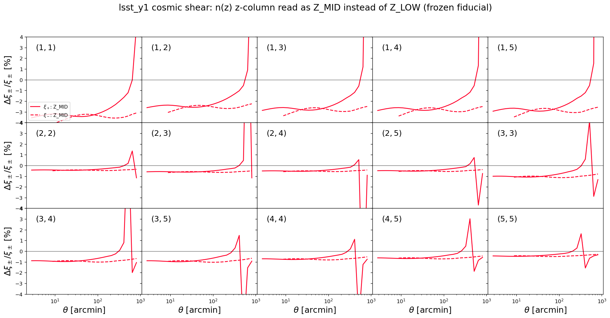
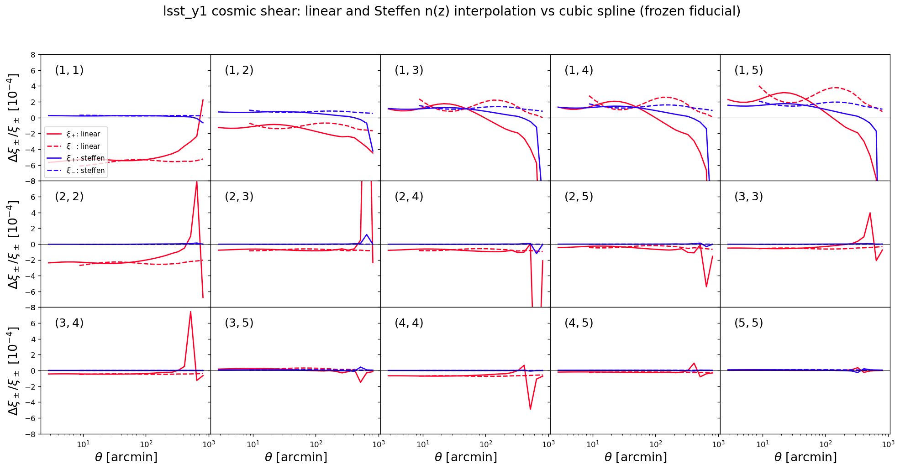

# Data-vector and likelihood tests

The frozen snapshot `frozen/` and its manifest `manifest_sha256.json`
live in the parent `tests/` directory; the paths below are relative to
it.

These tests catch two kinds of silent breakage: a $\chi^2$ that drifted
because code or data changed by accident, and a race condition (a bug
where evaluating several points in a row corrupts a later result
through leftover internal state or colliding OpenMP threads). These
tests also measure the accuracy of the hybrid emulated pipelines and
report whether they are accurate enough for data analysis (advisory:
no pass/fail).

The mechanism of every shared check family - the frozen-reference and
race contract, the zero-baseline construction, the sweeps and their
`--high`/`--mask` options, the accuracy settings and their meanings -
is documented once in
[the shared data-vector checks](https://github.com/CosmoLike/cocoa-cosmolike-core/blob/main/README.md#dv_checks)
of the CosmoLike core. This file records what LSST-Y1 runs and what it
measured.

# Table of contents

1. [Running the tests](#run_tests)
2. [The tests](#the_tests)
    1. [The CFASTPT vs FASTPT comparison](#cfastpt_fastpt)
    2. [The Halofit vs EE2 checks](#halofit_ee2)
    3. [The EE2 modification tests](#ee2_tests)
    4. [Advisory checks](#advisory_checks)
    5. [Scale-cut diagnostics](#scale_cut_diagnostics)
    6. [Accuracy checks](#accuracy_checks)
    7. [The N-random-models check](#nmodels_check)
    8. [Baryonic feedback checks](#baryon_checks)
    9. [The photo-z convention checks](#photoz_conventions)
    10. [The non-Limber checks](#nonlimber_checks)
    11. [The sector-ladder cache check](#cache_ladder)
3. [Appendix](#appendix)
    1. [FAQ: What does this project's snapshot hold?](#frozen_copy)
    2. [FAQ: How can maintainers refresh the snapshot?](#refreeze)

## Running the tests 

We assume users are in the Conda cocoa environment from a previous
`conda activate cocoa` command, that the shell is bash, and that the
current folder is the cocoa main folder `cocoa/Cocoa`. Every command
below assumes `start_cocoa.sh` has been sourced once:

    source start_cocoa.sh

Run the full suite with

    python -m pytest ./projects/lsst_y1/tests/data_vector

or, without pytest,

    python -m unittest discover -s ./projects/lsst_y1/tests/data_vector -v

The tests change no project files. Each test prints a progress line
per model build and per evaluation, then a report with the computed
$\chi^2$, the stored reference, the difference, and the pass limit.
A full run performs about 207 likelihood evaluations and takes a few
minutes. The test files force `OMP_NUM_THREADS=4` internally.

## The tests 

The standard configurations get four tests each - the frozen-reference
drift check and the race check, in NLA and in TATT
([mechanism](https://github.com/CosmoLike/cocoa-cosmolike-core/blob/main/README.md#dv_frozen)).
The TATT variants set

    IA_model: 1
    LSST_A2_1: 0.05
    LSST_BTA_1: 0.05
    LSST_A2_2: -1.51541

The suite follows the shared
[test-file naming convention](https://github.com/CosmoLike/cocoa-cosmolike-core/blob/main/README.md#dv_naming): a file name
means the same thing in every project. This project's
configurations and test numbers:

| file | configuration | tests |
|---|---|---|
| `test_example1.py` | cosmic shear | 1-4: drift and race, in NLA then TATT |
| `test_example2.py` | 3x2pt | 5-8: drift and race, in NLA then TATT |
| `test_fastpt.py` | TATT with python FAST-PT (`IA_code: 1` plus the fastpt theory block) instead of the C cfastpt, on cosmic shear and 3x2pt | 9, 10: $\chi^2$ vs their own stored FASTPT references; each prints the FASTPT-minus-CFASTPT difference next to its stored value |
| `test_example2_2x2pt.py` | 2x2pt (`lsst_y1.combo_2x2pt`, the 3x2pt configuration reduced to galaxy clustering plus galaxy-galaxy lensing) | 11-14: drift and race, in NLA then TATT |
| `test_fastpt.py` | the sweep on cosmic shear, the 3x2pt likelihood (`lsst_y1.combo_3x2pt`) and the 2x2pt likelihood (`lsst_y1.combo_2x2pt`) | 15, 16, 17 |
| `test_ee2.py` | the installed, modified EuclidEmulator2 vs the pre-modification build (commit `ff59f66`), compiled side by side at test time, cosmic shear with NLA | 18: $\Delta\chi^2$ at ten fixed cosmologies, below 0.2 |
| `test_ee2.py` | cosmic shear, NLA with EE2 (`non_linear_emul: 1`) | 19: race, including EE2's own threaded compute |

### The CFASTPT vs FASTPT comparison (`test_fastpt.py`, tests 15-17) 

The sweep mechanism, the zero-baseline construction and the
`--high`/`--mask` options are in
[the shared checks](https://github.com/CosmoLike/cocoa-cosmolike-core/blob/main/README.md#dv_fastpt).
Here, test 15 runs it on cosmic shear, test 16 on the 3x2pt likelihood
and test 17 on the 2x2pt likelihood. In test 16 the frozen
configuration fixes the one-loop bias amplitudes (`LSST_B2_*`) at
zero, so the sweep scores the intrinsic-alignment tables alone on the
wider data vector; in test 17 the TATT tables are scored through
galaxy-galaxy lensing alone.

The LSST-Y1 scale-cut masks `--mask` accepts: `frozen` (the default)
keeps the M1 mask of the frozen contract (959 of the 1,560 data
points); `M2` to `M5` cut progressively more points (854, 749, 659,
569) and `M6` fewer (1,378); `ones` keeps every point.

#### Why the defaults are the converged configuration 

This is a decision record, built from this check's own sweeps.

- Before the two-grid upgrade of the fastpt theory block (2026-09)
  there was no upsampling: one shared 1,100-point grid played both
  roles, and the difference against cfastpt reached
  $\Delta\chi^2 = 21$ across the intrinsic-alignment prior.
- Separating the two grids located the entire divergence in the
  density of the interpolated table and none of it in the
  convolutions.
- Raising the internal grid alone moves nothing (max
  $\Delta\chi^2 = 0.00830$ at 1,100 points, 0.00827 at 4,900, output
  fixed at the default): the convolutions were already accurate on
  their default grid, and the dense splined table removes the
  interpolation error at almost no cost.

Table measured on 2026-09-22 (cosmic shear, test 15):

| output table (points) | internal grid (points) | max $\Delta\chi^2$ | Runtime / first row |
|---|---|---|---|
| 1,100 | 1,100 (shared) | 21.40 | 1.00 |
| 16,900 | 1,100 | 0.125 | 1.00 |
| 128,900 | 1,100 | 0.0118 | 1.04 |
| 1,024,900 (`accuracyboost: 1`, the default) | 1,100 (the default) | 0.0082 | 1.33 |
| 2,048,900 (`accuracyboost: 2`) | 1,300 (`internal_accuracyboost: 2`) | 0.0080 | 1.62 |

Runtime ratios use the first row of this table as the baseline, with the
same timed scope and machine. They compare sampling costs within this
project; absolute runtimes depend on the machine.

Measured on 2026-09-23:

- Test 16 (3x2pt): max $\Delta\chi^2 = 0.00018$ at the defaults,
  $0.00008$ at the pushed camb/cosmolike settings - smaller than
  cosmic shear's 0.0082 at the same points under the 3x2pt masked
  covariance.
- Test 17 (2x2pt): max $\Delta\chi^2 = 0.00004$ at the defaults and
  $0.00001$ pushed, the mildest of the three, with the TATT tables
  entering through galaxy-galaxy lensing alone.
- b2-activated variant (exploratory, not a shipped test:
  `LSST_B2_* = 1.0` fixed in BOTH implementations, every other
  setting the frozen 3x2pt contract): the one-loop galaxy-bias
  tables the frozen configuration turns off measure max
  $\Delta\chi^2 = 0.044$, with a floor of 0.013 at the IA-off null
  where only the bias tables differ. Doubling the FAST-PT boosts
  moves nothing (0.044408 to 0.044394): a density-independent
  numerics difference between the two bias implementations, well
  inside the 0.2 limit.
- `--mask=ones` (no scale cuts, all 1,560 points weighted): every
  sweep still passes. Cosmic shear measures max
  $\Delta\chi^2 = 0.097$ at the default
  camb/cosmolike settings - twelve times its M1 value, insensitive
  to the FAST-PT boosts - and 0.00012 at the pushed settings: the
  unmasked small scales amplify cosmolike's default integration
  error, not a FAST-PT grid deficiency. 3x2pt and 2x2pt measure
  0.0029 and 0.0027 at the defaults, 0.0015 and 0.0014 pushed.

> [!NOTE]
> The fastpt defaults hold this accuracy on their own; raising the
> boosts is a convergence test, not a need. cfastpt (`IA_code: 0`)
> remains the reference implementation.

Run the comparison at the default and at the pushed camb/cosmolike
settings (the full comparison is both invocations):

    python -m pytest ./projects/lsst_y1/tests/data_vector/test_fastpt.py
    python -m pytest ./projects/lsst_y1/tests/data_vector/test_fastpt.py --high=1

### The Halofit vs EE2 checks (`test_nonlinear.py`, NL1-NL2) 

[Mechanism](https://github.com/CosmoLike/cocoa-cosmolike-core/blob/main/README.md#dv_halofit_ee2):
NL1 evaluates the cosmic-shear data vector and NL2 the 3x2pt one, each
with both nonlinear-power sources at the ten shared cosmologies.
Measured on 2026-09-23 (the figure below, frozen M1 mask):

- NL1 (cosmic shear): median $\Delta\chi^2$ 23.2, maximum 189.1;
  33.0 and 329.0 under `--mask=ones`.
- NL2 (3x2pt): median 25.4, maximum 204.0, largest at the
  high-omegam draws; median 4,292 and maximum 12,991 under
  `--mask=ones`.
- At the frozen cuts the shear block alone carries nearly the whole
  3x2pt disagreement, and the two nonlinear-P(k) sources are not
  interchangeable at this project's precision; without cuts the
  disagreement is dominated by the small scales the masks remove.

### The EE2 modification tests (`test_ee2.py`, tests 18-19) 

[Mechanism](https://github.com/CosmoLike/cocoa-cosmolike-core/blob/main/README.md#dv_ee2):
test 18 pins the physics of Cocoa's EuclidEmulator2 modifications
against the pre-modification build (commit `ff59f66`); test 19 is the
race check with EE2 on. Measured on 2026-09-23:

- Test 18: max $\Delta\chi^2 = 8.6\times10^{-6}$ over the ten
  cosmologies (the modifications change no emulated physics).
- Test 19: the fresh and 10th-in-a-row fiducial agree to all eight
  printed decimals.

### Advisory checks (`test_emul2.py`, E1-E4) 

These checks test the hybrid emulators: trained machine-learning
networks replace the Boltzmann code. There is no pass/fail; each
check prints four quantities:

| printed quantity | meaning |
|---|---|
| emulator $\chi^2$ | the emulated pipeline evaluated at the fiducial point |
| drift | change against the stored emulator reference; nonzero means the installed emulator no longer reproduces its stored $\chi^2$ |
| $\lvert\chi^2_\text{emulator} - \chi^2_\text{exact}\rvert$ | the emulator error against the exact-physics $\chi^2$ at the same cosmology |
| recommendation | RECOMMENDED for actual data analysis when $\lvert\chi^2_\text{emulator} - \chi^2_\text{exact}\rvert < 0.2$, NOT recommended otherwise |

A race-condition check (OpenMP threading) runs as well, warning
instead of failing.

> [!NOTE]
> The trained-network files are read from
> `external_modules/data/emultrf`, not from the `frozen/` snapshot; the
> network device is pinned to `cpu` so the numbers do not depend on
> GPU availability.

Run them on their own:

    python -m pytest ./projects/lsst_y1/tests/data_vector/test_emul2.py

### Scale-cut diagnostics (`test_scale_cut_diagnostics.py`) 

The scale-cut diagnostics of 2011.06469 eq 17 — dlnC_ss/dlnk,
dlnxi_pm/dlnk, and the response functions rf_C_ss and rf_xi — are
notebook-facing functions with no role in the likelihood, so this
test is their only automated coverage. It checks, in one process on
the frozen TATT cosmic-shear fiducial, that every scalar and array
overload returns finite values, that the scalar overloads agree with
the matching array entries (they share the batch engines), and that
the response functions behave as normalized cumulative fractions.

The multipoles $\ell \le 20$ take a separate low-$`\ell`$ branch of
rf_C_ss. If $k$ underflowed to zero inside its normalization integrand
there, a guard would stop the process with `exit(1)`, which also kills
a Jupyter kernel running the notebook derivative cells; the test
evaluates $\ell = 3$ and 10 to keep that branch under check.

### Accuracy checks (`test_accuracy.py`, A1-A6) 

[Mechanism, setting meanings and cost order](https://github.com/CosmoLike/cocoa-cosmolike-core/blob/main/README.md#dv_accuracy):
check A0 scans one setting at a time on the 3x2pt NLA configuration
(including `accuracyboost: 5` as a stress test); A1-A6 re-evaluate
cosmic shear, 3x2pt and 2x2pt, in NLA and TATT, with every setting
pushed at once. This project's pushed values:

| setting | raised to |
|---------|-----------|
| `accuracyboost` (cosmolike) | 3 |
| `integration_accuracy` (cosmolike) | 10 |
| `internal_accuracyboost` (cosmolike) | 2 |
| `lmax` (cosmolike) | 200000 |
| `kmax_boltzmann` (cosmolike) | 40 |
| `AccuracyBoost` (CAMB) | 2 |
| `k_per_logint` (CAMB) | 50 |
| `kmax` (CAMB) | 50 |

Every likelihood yaml of this project and the notebook wrappers set
`internal_accuracyboost: 1.0`, the exact single-grid path; the C
library's own default, 0.5 (`structs.c`), applies only where no
caller sets it.

- 2026-09-25: the lsst_y1 scan measured
  $\Delta^T C^{-1} \Delta \le 10^{-9}$ against the single-grid path
  down to 0.27.

Run them on their own, or skip them (high-accuracy evaluations take
minutes):

    python -m pytest ./projects/lsst_y1/tests/data_vector/test_accuracy.py
    python -m pytest ./projects/lsst_y1/tests/data_vector --ignore ./projects/lsst_y1/tests/data_vector/test_accuracy.py

### The N-random-models check (opt-in) 

[Mechanism](https://github.com/CosmoLike/cocoa-cosmolike-core/blob/main/README.md#dv_nmodels):
seeded random points across the 3x2pt NLA prior, each scored
high-accuracy against its own default-settings vector. Enable and run
it with

    COCOA_ACCURACY_NMODELS=10 python -m pytest \
        ./projects/lsst_y1/tests/data_vector/test_accuracy.py -k nmodels

Running the file as a script accepts `--nmodels N` in place of the
environment variable.

### Baryonic feedback checks (`test_accuracy_baryons.py` BF0-BF7, `test_baryons.py` BD1-BD7) 

[Mechanism](https://github.com/CosmoLike/cocoa-cosmolike-core/blob/main/README.md#dv_baryons):
the accuracy checks (BF) report the default-versus-pushed
$\Delta\chi^2$ with each feedback method on; the drift tests (BD) pin
each method's frozen prediction. Run them with

    python -m pytest ./projects/lsst_y1/tests/data_vector/test_accuracy_baryons.py
    python -m pytest ./projects/lsst_y1/tests/data_vector/test_baryons.py

### The photo-z convention checks (`test_photoz_conventions.py`) 

[Mechanism](https://github.com/CosmoLike/cocoa-cosmolike-core/blob/main/README.md#dv_photoz):
the frozen cosmic-shear fiducial under the default, each alternative
convention, and the default again. Measured on 2026-09-24:

- default: $\chi^2 = 0.267263$ (the frozen reference exactly).
- linear: $\Delta\chi^2 = 6.3\times10^{-4}$; Steffen:
  $\Delta\chi^2 = 4.1\times10^{-5}$. Either interpolant change is far below
  the survey's statistical precision.
- Z_MID: $\Delta\chi^2 = 1.63$ - the half-bin z-column reading
  is the one photo-z convention that matters at this precision.

The figures below are regenerated by
`generate_photoz_convention_figure.py`:

### The non-Limber checks (`test_nonlimber_ggl.py`, `test_nonlimber_gg.py`) 

[Mechanism](https://github.com/CosmoLike/cocoa-cosmolike-core/blob/main/README.md#dv_nonlimber):
`adopt_limber_gs` and `adopt_limber_gg` are both `0` (non-Limber
below $\ell = 150$) in this project, because the measured differences
below are too large to absorb.

Galaxy-galaxy lensing, measured on 2026-10-01 (the test stores
`DCHI2_MEASURED = 1.904`):

- $\Delta\chi^2 = 1.90$ for the 3x2pt data vector (1.86 on
  2026-09-27).
- The largest contributions come from the pairs with lens bin = source
  bin, (1,1), (0,0), (3,3), (2,2) with 0.66, 0.65, 0.43, 0.38, and
  from pairs with the source bin in front of the lens bin, (3,2) and
  (4,3) with 0.39 and 0.21 (their signal is the intrinsic alignment
  of the sources times the lens density, two narrow kernels).

Galaxy clustering, measured on 2026-10-01 (the test stores
`DCHI2_MEASURED = 151.8`):

- $\Delta\chi^2 = 152$ for the 3x2pt data vector, against 1.90 for
  the same comparison in galaxy-galaxy lensing.
- It grows with lens redshift: lens bins 4, 3, 2, 1, 0 contribute
  $\Delta\chi^2 =$ 57.9, 50.1, 27.7, 16.6, 4.1 (each bin's block alone).
- 148 on 2026-09-28; the core and likelihood changes since moved it
  by 2.5% (not separated).

### The sector-ladder cache check (`test_cache_consistency.py`) 

The deterministic mixed-update ladder and its bitwise assertions are
described in
[the shared checks](https://github.com/CosmoLike/cocoa-cosmolike-core/blob/main/README.md#dv_cache_ladder);
this project runs it on its cosmic-shear configurations in both
intrinsic-alignment models.

## Appendix 

## :interrobang: FAQ: What does this project's snapshot hold? 

The snapshot-protection mechanism is described in
[the shared checks](https://github.com/CosmoLike/cocoa-cosmolike-core/blob/main/README.md#dv_frozen).
This project's `frozen/` holds:

| `frozen/` entry | holds |
|---|---|
| `frozen_config_example1.py` | cosmic shear: the complete cobaya configuration as a yaml string, plus the exact evaluation point |
| `frozen_config_example2.py` | 3x2pt: the complete cobaya configuration as a yaml string, plus the exact evaluation point |
| `frozen_config_example2_2x2pt.py` | 2x2pt: the complete cobaya configuration as a yaml string, plus the exact evaluation point |
| `frozen_config_emul2_example1.py` | cosmic shear with the hybrid emulators: the complete cobaya configuration as a yaml string, plus the exact evaluation point |
| `frozen_config_emul2_example2.py` | 3x2pt with the hybrid emulators: the complete cobaya configuration as a yaml string, plus the exact evaluation point |
| `data/` | the tests' own copy of the data vectors, covariance, n(z), and masks, plus the TATT and baryonic-feedback vectors the generator writes |
| `reference_chi2.json` | the reference $\chi^2$ values, one per configuration and variant |
| `EXAMPLE_EVALUATE1.yaml` | snapshot of the cosmic-shear example, kept only so a human can diff how the live example drifted since the freeze |
| `EXAMPLE_EVALUATE2.yaml` | snapshot of the 3x2pt example, kept only so a human can diff how the live example drifted since the freeze |
| `EXAMPLE_EMUL2_EVALUATE1.yaml` | snapshot of the hybrid cosmic-shear example, kept only so a human can diff how the live example drifted since the freeze |
| `EXAMPLE_EMUL2_EVALUATE2.yaml` | snapshot of the hybrid 3x2pt example, kept only so a human can diff how the live example drifted since the freeze |

All TATT variants evaluate against `frozen/data/tatt_lsst_y1.dataset`,
the synthetic vector generated at freeze time
([why](https://github.com/CosmoLike/cocoa-cosmolike-core/blob/main/README.md#dv_frozen)).

## :interrobang: FAQ: How can maintainers refresh the snapshot? 

A deliberate change to the data vectors, n(z), covariance, examples,
or likelihood defaults requires a re-freeze. The `_meta` block of
`frozen/reference_chi2.json` records when the current references were
generated.

We assume users are in the Conda cocoa environment from a previous
`conda activate cocoa` command, that the shell is bash, and that the
current folder is the cocoa main folder `cocoa/Cocoa`.

**Step :one:**: activate the private Python environment by sourcing
the script `start_cocoa.sh`

    source start_cocoa.sh

**Step :two:**: rebuild the snapshot

    python ./projects/lsst_y1/tests/generate_frozen_reference.py --overwrite

It deletes and rebuilds `frozen/` from the current project, prints one
reference $\chi^2$ per configuration and variant (ten values), and
rewrites the manifest. This step does not write the baryonic-feedback
vectors of `test_baryons.py`.

**Step :three:**: write the baryonic-feedback vectors

    python ./projects/lsst_y1/tests/generate_frozen_reference.py --baryons

It evaluates each feedback method once, writes its vector and dataset
file under `frozen/data/`, and re-pins the manifest. Review the
printed $\chi^2$ values of both steps before committing: they become
the new references the tests compare against.
